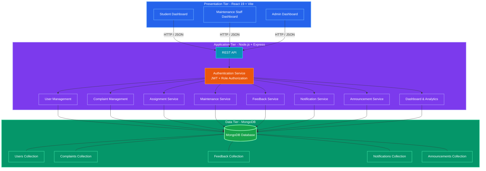

# HostelCare architecture and delivery plan

## Existing architecture

HostelCare is a single-repository application with separate `backend` and `frontend` packages. The backend is a CommonJS Express 5 API backed by MongoDB through Mongoose. `src/server.js` loads environment variables, validates the JWT secret, connects MongoDB, and starts the HTTP server. `src/app.js` configures Helmet, allow-listed CORS, JSON parsing, request logging, static complaint uploads, the health check, API routers, and centralized not-found/error handling.

The React 19/Vite frontend is an ES module application. `src/App.jsx` defines public and role-protected routes; `AuthContext` manages the bearer token and current user; `DashboardLayout` provides role navigation; and `services/api.js` is the shared Axios client. Tailwind CSS v4 supplies shared UI classes. There is no websocket/event broker or separate background worker configured.

## Existing data models and API routes

| Model | Existing purpose |
|---|---|
| `User` | Student, admin, and maintenance staff accounts; hashed passwords and hostel/block/room profile fields. |
| `Complaint` | Complaint details, priority/status, assignment, hostel location, image path, resolution note, and status history. |
| `Notification` | Per-user in-app notification and read state, currently linked to complaints. |
| `Feedback` | Student feedback and rating for resolved complaints. |
| `Announcement` | Admin-published, audience-targeted hostel notices and read state. |

| Router | Existing API responsibilities |
|---|---|
| `/api/auth` | Registration, login, and current-user lookup. |
| `/api/complaints` | Complaint creation/list/detail, student dashboard, assignment, priority, status, close, and reopen operations. |
| `/api/admin` | Admin dashboard/reports, users, staff creation, and user-role changes. |
| `/api/staff` | Staff dashboard and assigned work. |
| `/api/notifications` | List notifications and mark one/all read. |
| `/api/feedback` | Submit and review complaint feedback. |
| `/api/announcements` | Admin publishing and role-targeted announcement feeds. |

Authorization is enforced by `protect` and `authorize`; complaint detail access additionally checks ownership or staff assignment. Request validation uses `express-validator`. Multer holds one image in memory (5 MB maximum) and accepts JPEG/PNG/WebP MIME types before writing generated filenames to `backend/uploads`.

## Reusable frontend components

- `ProtectedRoute` gates pages by role.
- `DashboardLayout` supplies responsive role navigation and `NotificationBell`.
- `ComplaintStatusBadge`, `FeedbackForm`, and `NotificationBell` are existing shared UI.
- Existing card, form, and button classes are in `frontend/src/index.css`.
- `api.js` handles the API base URL, JWT header, upload paths, and standard API error messages.

## Issues relevant to the requested work

- Complaint locations are currently free-form client fields; without server verification, the client can submit any location strings.
- Complaint locations are entered manually; the QR location workflow has been removed.
- Announcement publishing, audience access, and notification behavior are implemented.
- The frontend stores JWTs in `localStorage`, which is exposed to same-origin script execution. This remains an existing platform-level tradeoff and should be revisited alongside an HttpOnly-cookie/XSS strategy.
- Upload checks rely on the client-supplied MIME type; file signature inspection and private/protected image delivery need a separate security-hardening pass.
- Most resource IDs are not validated consistently across all existing complaint/admin routes; the Phase 2 additions will validate their own IDs and payloads.
- Notifications are currently fetched on page load; no websocket or event-bus infrastructure exists for real-time delivery.

## Incremental implementation plan

### Phase 1 — inspection and architecture record

- Record the current system boundaries, models, routes, reusable UI, relevant security concerns, and exact planned files in this document.
- Preserve the pre-existing working-tree whitespace-only change in `backend/src/app.js`.

### Phase 2 — announcements and earlier QR workflow

Backend files to add/change:

- Announcement models, controllers, routes, validators, and tests are implemented.
- QR location models, routes, validation, and complaint token verification have been removed; complaints retain manual hostel/block/room fields.

Frontend files to add/change:

- Admin announcement management and user-facing announcement pages are implemented.
- The dedicated admin area lists registered accounts with role filtering and pagination.
- QR generation/scanning packages, screens, and requests have been removed.
- Update `README.md` with the new setup/use flow and endpoint reference; no additional environment variables are required.
- `postman/HostelCare.postman_collection.json` includes announcement workflow requests and no QR endpoints.

### Phase 3 — emergency SOS and complaint escalation

- Extend existing complaint/notification/admin patterns with separate emergency records, audited emergency transitions, SLA policy configuration, due-time tracking, and restart-safe escalation processing.
- Select and document a persistent scheduling/worker approach before implementing the SLA scheduler; the current project has no job queue or worker.
- Add authorization, idempotency, audit, and lifecycle tests.

### Phase 4 — dashboard/UI redesign

- Improve student/admin/staff dashboards using the current layout, shared classes, and Lucide icons while preserving existing workflows.
- Add dark mode, skeleton/empty states, responsive navigation, and test the important workflows.

### Phase 5 — production/security verification

- Review auth, permissions, ID/payload validation, uploads, rate limits, CORS, headers, error output, secret configuration, indexes, and sensitive response fields.
- Run backend and frontend suites, focused build/lint checks, and document actual outcomes.
- Update README and environment-variable examples if new deployment settings become necessary.

